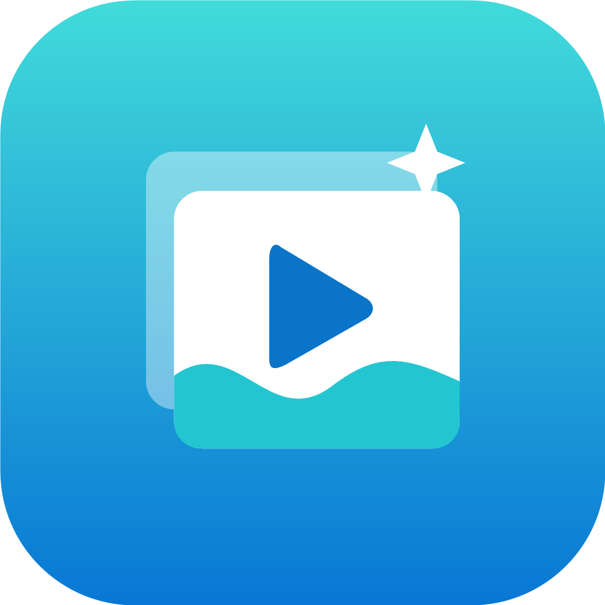

# 해양대 GIF 스튜디오 · Android

사이트 <https://chocoboy1923.github.io/gift-trasfrom-final/>를 전체화면으로 표시하는 Android WebView 앱입니다. Android Studio 없이 GitHub Actions에서 설치용 APK를 빌드합니다.



## 포함 기능

- 상태 표시줄·내비게이션 바를 숨기는 전체화면. 화면 가장자리 스와이프로 시스템 바를 잠시 표시합니다.
- 이미지 여러 장 및 동영상 선택. Android 시스템 파일 선택기를 사용합니다.
- 사이트에서 생성한 GIF를 시스템의 **다른 이름으로 저장** 창으로 저장합니다. 저장 위치와 파일 이름을 선택할 수 있습니다.
- 48KiB 단위로 전송하는 Blob 다운로드 처리, 저장 취소 및 실패 처리. GIF 한 개당 최대 512MB입니다.
- 동영상 전체화면, 가로·세로 회전, 뒤로 가기, 종료 확인, 네트워크 오류 시 재시도.
- 바다색 그라데이션·프레임·재생 버튼을 조합한 Android 적응형 아이콘. PNG 1024px와 SVG 원본도 포함합니다.
- 지정 사이트 외부 링크는 외부 브라우저로 엽니다. 파일 전체 접근 권한이나 사진 라이브러리 전체 권한을 요청하지 않습니다.

## 1. GitHub에 프로젝트 올리기

1. GitHub에서 새 저장소를 만듭니다. 예: `haeyang-gif-android`.
2. 제공 ZIP을 압축 해제합니다.
3. 저장소에서 **Add file → Upload files**를 선택합니다. 빈 저장소라면 **uploading an existing file**을 선택합니다.
4. `haeyang-gif-android` 폴더 **안의 파일과 폴더 전체**를 업로드하고 **Commit changes**를 누릅니다. ZIP 자체를 올리지 마세요.
5. 저장소 최상위에 아래 구조가 있는지 확인합니다. 특히 `.github/workflows/build-android.yml`, `gradle/wrapper/gradle-wrapper.jar`, `ci/debug.keystore`가 필요합니다.

```text
.github/workflows/build-android.yml
app/
ci/debug.keystore
gradle/wrapper/
tests/
build.gradle
settings.gradle
gradlew
gradlew.bat
README.md
```

`haeyang-gif-android/app/...`처럼 프로젝트 폴더가 한 겹 더 들어가면 자동 빌드가 인식되지 않습니다. 기존 웹사이트 저장소와 별도의 앱 저장소를 사용하는 구성을 기준으로 했습니다. 사이트 원본을 수정할 필요는 없습니다.

## 2. APK 빌드 및 다운로드

1. `main` 또는 `master` 브랜치에 업로드하면 **Build Android APK**가 자동 실행됩니다.
2. 수동 실행은 저장소의 **Actions → Build Android APK → Run workflow → Run workflow**입니다.
3. 실행 결과가 초록색 체크가 될 때까지 기다립니다. 첫 빌드는 도구 다운로드 때문에 수 분 걸릴 수 있습니다.
4. 해당 실행 화면 아래 **Artifacts → haeyang-gif-studio-apk**를 다운로드합니다. 다운로드하려면 GitHub 로그인이 필요할 수 있습니다.
5. 받은 ZIP을 풀면 **haeyang-gif-studio.apk**와 SHA-256 체크섬 파일이 있습니다.

Actions가 비활성화되어 있다면 저장소의 Actions 탭에서 활성화하세요. 조직 저장소는 조직의 Actions 사용 정책이 적용됩니다. PR에서도 검증 빌드를 실행합니다.

## 3. 휴대폰에 설치

1. `haeyang-gif-studio.apk`를 Android 휴대폰으로 보냅니다.
2. 휴대폰에서 APK 파일을 엽니다.
3. Android가 요청하면 해당 파일 앱 또는 브라우저에 **이 출처의 앱 설치 허용**을 설정하고 설치합니다.
4. 앱에서 이미지 선택 → GIF 만들기 → 다운로드 → 저장 위치 선택까지 확인합니다. 동영상 변환도 같은 방식으로 저장합니다.

지원 범위는 **Android 8.0(API 26) 이상**입니다. Chrome과 Android System WebView는 최신 버전을 권장합니다. 인터넷 연결이 필요하며, GIF 변환은 원래 웹사이트의 코드가 담당합니다. 큰 동영상·많은 프레임은 기기 메모리에 따라 실패할 수 있습니다.

## 서명과 배포

기본 결과는 **직접 설치 가능한 개발용 서명 APK**입니다. 포함된 `ci/debug.keystore`는 공개 개발용 키이며 비밀번호와 별칭은 Android 기본값입니다(`android` / `androiddebugkey`). 매번 같은 키를 사용하므로 이 프로젝트로 빌드한 APK끼리는 업데이트 설치할 수 있습니다. 버전은 `app/build.gradle`의 `versionCode`와 `versionName`으로 관리합니다.

이 공개 키는 정식 배포·Play Store용이 아닙니다. 정식 배포에는 본인만 보관하는 릴리스 키와 별도 서명 설정이 필요합니다. 개발용 앱에서 별도 키를 사용하는 앱으로 바꾸려면 기존 앱 삭제가 필요할 수 있습니다. 이 프로젝트에는 릴리스 비밀키나 계정 정보가 없습니다.

## 프로젝트 설정

| 항목 | 값 |
| --- | --- |
| 앱 표시 이름 | 해양대 GIF 스튜디오 |
| 패키지 | `kr.haeyang.gifstudio` |
| 최소 Android | 8.0 / API 26 |
| compileSdk / targetSdk | 35 / 35 |
| Java | 17 |
| Android Gradle Plugin | 8.9.2 |
| Gradle Wrapper | 8.11.1, SHA-256 검증 |
| AndroidX WebKit | 1.12.1 |

Gradle 버전은 [Android 공식 AGP 8.9 호환성 문서](https://developer.android.com/build/releases/agp-8-9-0-release-notes)에 맞췄습니다. 특정 버전을 고정해 동일한 환경으로 빌드합니다.

- 주소 변경: `MainActivity.java`의 `HOME`, `trusted()` 경로·호스트, 메시지 브리지의 허용 origin을 함께 바꿉니다.
- 아이콘 수정: `res/drawable/ic_launcher_*.xml`과 `res/mipmap-anydpi-v*/ic_launcher.xml`.
- `icon.svg`, `icon-1024.png`는 디자인 원본·미리보기입니다. 실제 앱은 선명한 벡터 리소스를 사용합니다.

로컬에 JDK 17과 Android SDK가 있다면 다음으로 동일하게 검증할 수 있습니다.

```sh
node --test tests/download-bridge.test.cjs
./gradlew assembleDebug lintDebug
```

Windows에서는 `gradlew.bat assembleDebug lintDebug`를 사용합니다. SDK 경로는 `ANDROID_HOME` 환경변수나 개인 `local.properties`로 설정하며 저장소에 업로드하지 않습니다.

## 기기에서 확인할 항목

- 실행 시 브라우저 주소창 없이 전체화면으로 사이트가 표시되는지.
- 이미지 여러 장으로 만든 GIF와 동영상으로 만든 GIF가 파일 앱에 저장되고 재생되는지.
- 파일 선택 및 저장 창 취소 후 다시 선택·저장이 되는지.
- 화면 회전 시 작업이 유지되는지, 노치가 있는 기기에서 버튼이 가려지지 않는지.
- 오프라인 실행 시 재시도 화면이 나타나는지.

실제 기기에서의 WebView·파일 공급자·영상 코덱 조합은 별도 설치 확인이 필요합니다. GitHub 원격 실행은 프로젝트를 저장소에 올린 후 확인할 수 있습니다.
